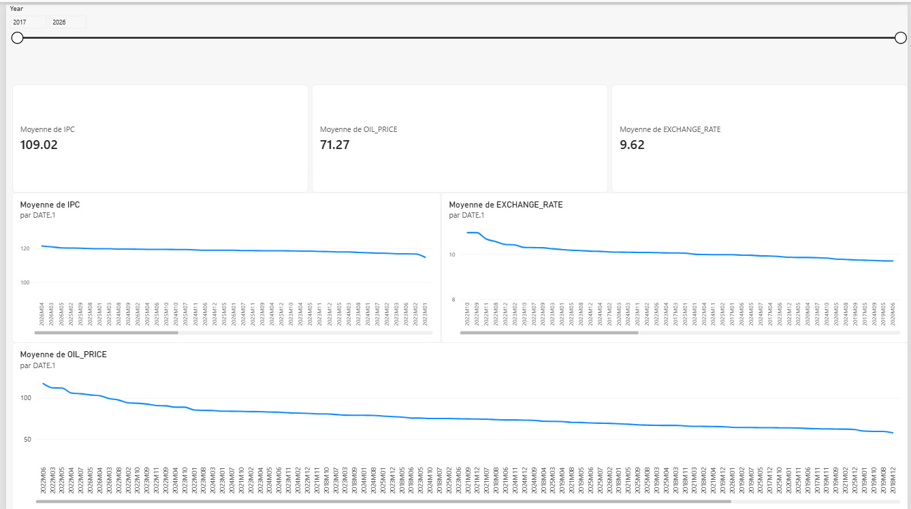

# Tableau de Bord Macroéconomique Interactif — Power BI

## Présentation du Projet
Ce projet porte sur la conception et le développement d'un rapport analytique interactif sous **Microsoft Power BI**, dédié au suivi et à l'analyse temporelle de trois indicateurs macroéconomiques clés :
* **Indice des Prix à la Consommation (IPC)**
* **Cours du Pétrole (Oil Price)**
* **Taux de Change (Exchange Rate)**

L'objectif principal est de structurer et traduire des séries chronologiques brutes en visualisations analytiques dynamiques afin d'optimiser l'exploration des données et l'aide à la décision.

---

## Aperçu du Dashboard

---

## Méthodologie et Outils
* **Microsoft Power BI** : Modélisation des données, conception des visuels et architecture du rapport.
* **Data Visualization** : Intégration d'indicateurs de performance clés (cartes KPI affichant les valeurs moyennes) et de graphiques linéaires pour l'analyse des tendances.
* **Interactivité** : Mise en place d'un segment temporel (Slicer) permettant un filtrage dynamique de l'ensemble des visuels par année.
* **Préparation des données** : Nettoyage, structuration et formatage des séries temporelles à partir d'une source Excel.

---

## Structure du Dépôt
* `Dashboard_Macroeconomique_PowerBI.pbix` : Fichier source complet du modèle et du rapport Power BI.
* `macro-data.xlsx.xlsx` : Jeu de données brut utilisé pour alimenter le tableau de bord.
* `Dashboard-preview.png.jpeg` : Capture d'écran du rendu final du rapport.

---

## Auteur
**Oussama Jellouly**  
*Data Analysis & Modélisation Économique et Financière*  
Profil GitHub : [github.com/oussamajellouly](https://github.com/oussamajellouly)
